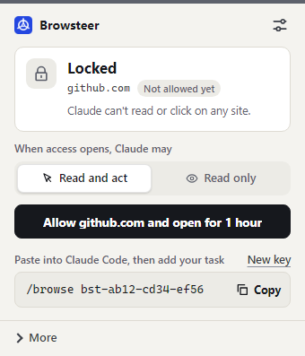
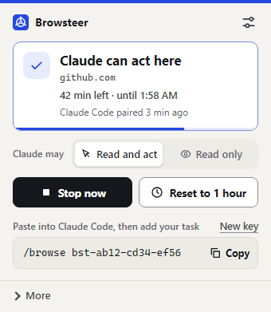
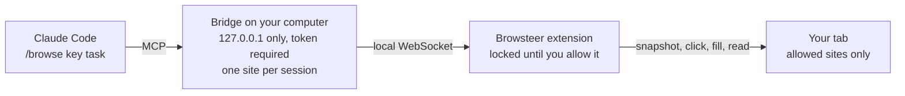
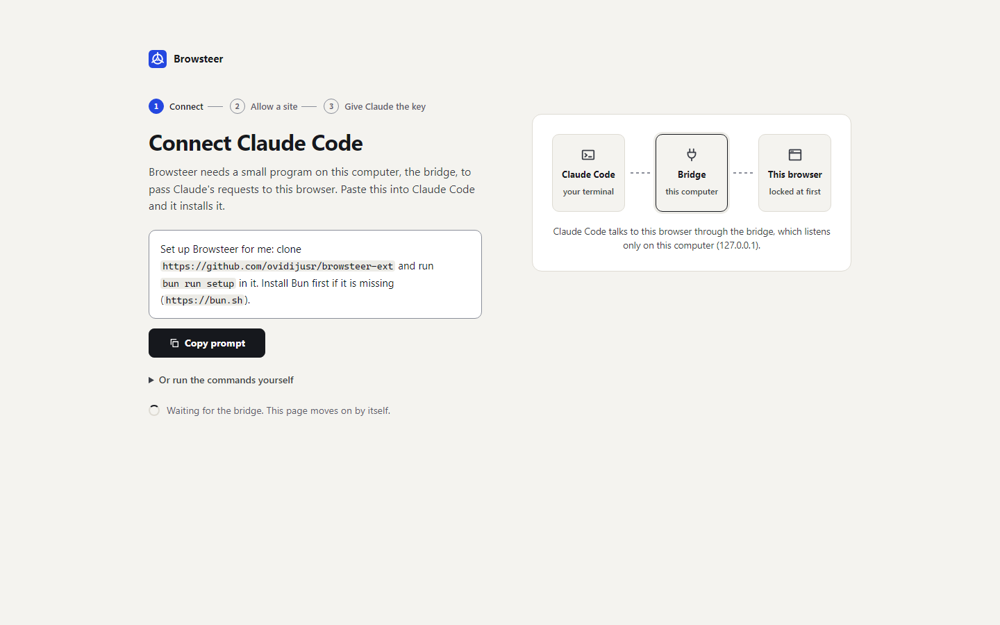

# Browsteer

Browsteer lets Claude Code read and use the pages in your own browser, where
you are already signed in, on the sites you allow and only while you allow it.

<p>
  
  
</p>



Claude sees each page as a short text outline of its headings, text, and
controls, not raw HTML. It then clicks, types, and reads by pointing at lines
in that outline. Browsteer works in Chrome, Edge, Brave, and Firefox.

## What it is good for

Use it for work that needs your signed-in browser:

- Fill in a long form on a site that has no API.
- Compare car or flat listings across several tabs and put them in a table.
- Read the numbers on a dashboard behind single sign-on.
- Find the JSON request a page makes, then fetch the data directly.
- Attach a file to a form, from one upload folder you control.

## Quickstart

You need [Claude Code](https://claude.com/claude-code) and
[Bun](https://bun.sh) 1.3 or newer.

1. Get the bridge and connect it to Claude Code. The easy way is to paste this
   into Claude Code:

   ```
   Set up Browsteer for me: clone https://github.com/ovidijusr/browsteer-ext and run `bun run setup` in it.
   ```

   Or run it yourself:

   ```sh
   git clone https://github.com/ovidijusr/browsteer-ext && cd browsteer-ext && bun run setup
   ```

   Setup installs the dependencies, builds the extension, adds Browsteer to
   Claude Code as an MCP server and adds the `/browse` command. The bridge it
   starts listens only on `127.0.0.1`.

2. Install the extension. Firefox users get it from
   [addons.mozilla.org](https://addons.mozilla.org/firefox/addon/browsteer/).
   For Chrome, Edge, and Brave, see [Install the extension](#install-the-extension).

3. Open the page you want help with and click the Browsteer toolbar button.
   Click **Allow ‹site› and open for 1 hour**, then **Copy** the `/browse`
   command. Paste it into Claude Code and add your task:

   ```
   /browse bst-ab12-cd34-ef56 list the open pull requests on this page
   ```

## Two browsers at once

Paste more than one key to check the same page in different browsers, for example Edge
and Firefox:

```
/browse bst-ab12-cd34-ef56 bst-gh78-jk90-mn12 check that the signup form validates the same in both
```

Claude pairs with each browser and can name one per step. With `browser_compare` it runs
the same steps in each browser in one call and gets back only what differs: the address, the
title, form values and error messages, a disabled submit button, and optionally the page text.
A browser whose popup has Browsteer locked, or the site not allowed, is reported as refusing
rather than as a difference. Each browser's own popup still decides what Claude may do there,
and the session stays on one site in all of them.

## Safe by default

Your browser holds your accounts, so Browsteer starts locked and stays narrow.
You set these limits in the popup and in Settings. Neither Claude nor the
bridge can change them.

- **Locked until you open it.** Access lasts one hour and then closes by
  itself. **Stop now** closes it at once.
- **Only the sites you allow.** No site is allowed at first. Tabs on other
  sites are not even listed by name.
- **One site per session.** A session stays on the site where it started,
  unless you choose **More › Let Claude move to another site**.
- **Read only, if you want it.** Choose it in the popup before you open access.
  Claude can then look but not click, type, or navigate.
- **Final-sounding buttons need your yes.** Claude does not click buttons such
  as delete, pay, send, or sign out unless it says that you agreed.
- **Passwords stay hidden.** Password fields are always masked, and the log
  records typed text as a length only.
- **Uploads from one folder.** `browser_upload` sends only files you put in
  `~/Downloads/browsteer-upload`, up to 10 MB.
- **Local only.** The bridge listens on `127.0.0.1`, refuses connections from
  web pages, and requires a secret that only your user account can read.

Two wider options exist in **Settings** (the sliders icon in the popup), off by
default and marked dangerous: access *until I press Stop*, and *every site
except the ones I block*. Each asks for a confirmation, and while either is on
the popup turns red and says so.

A page can contain text that tries to trick Claude. These limits bound what a
fooled Claude can do, but on an allowed site it can still use ordinary
controls. Turn on read only when Claude only needs to look.
[SECURITY.md](SECURITY.md) lists every limit and what it does not cover.

Browsteer has no analytics and sends nothing off your computer by itself. What
Claude reads becomes part of your Claude Code conversation. The one exception
is semantic targeting, which is off by default; see
[Find controls by description](#find-controls-by-description).
[PRIVACY.md](PRIVACY.md) has the details.

## Install the extension

**Firefox** 140 or newer, desktop: install
[Browsteer from addons.mozilla.org](https://addons.mozilla.org/firefox/addon/browsteer/).
Firefox keeps it up to date.

**Chrome** 116 or newer, and Edge and Brave the same way:

1. Open `chrome://extensions` and turn on **Developer mode**.
2. Click **Load unpacked** and select the `dist/chrome` folder in your
   checkout. `bun run setup` builds that folder.

A setup guide opens after you install the extension. It moves on by itself as
the bridge connects, a site is allowed, and Claude pairs.

<p>
  
</p>

<details>
<summary>Manual setup, without <code>bun run setup</code></summary>

Run these from the repository root:

```sh
bun install
bun run build          # writes dist/chrome and dist/firefox
claude mcp add -s user browsteer -- bun run "$PWD/bridge/mcp.ts"
mkdir -p ~/.claude/skills && cp -R skill/browse ~/.claude/skills/browse
```

The last line installs the `/browse` command. To try your own Firefox build for
one session, open `about:debugging#/runtime/this-firefox`, click
**Load Temporary Add-on**, and select `dist/firefox/manifest.json`.

</details>

## Updating

When the extension and the bridge are on different versions, the popup says so
and offers a prompt to paste into Claude Code, which runs the update for you.
By hand:

```sh
bun run update      # pull, install, rebuild dist/, restart the bridge
```

Firefox and the Chrome Web Store update the extension by themselves. An
unpacked Chrome install needs **Reload extension** in the popup (or on the
extensions page) after `bun run update`.

## Find controls by description

`browser_find`, `browser_pursue`, and `browser_do` can find a control from a
description, such as "the export button next to the date range". They do this
by asking Jev, a paid model run by TypeSafe. Each question sends an outline of
the page to `api.typesafe.ai`, so the feature is off unless you turn it on.

To turn it on, create a key at
[console.typesafe.ai/keys](https://console.typesafe.ai/keys) and paste it into
**Settings › Find controls by description**. The bridge saves it in
`~/.config/typesafe/env`, readable only by you; the browser does not keep it.
`bun run setup` can also ask for the key.

While it is off, `browser_find` still finds controls named exactly and ones it
has learned before, without any network call.

## Stop

- **Stop now** in the popup closes access at once.
- **New key** in the popup ends the current pairing.
- `bun run hub:stop` stops the bridge.

## Learn more

- [SECURITY.md](SECURITY.md): every limit, what it does not protect against,
  and how to report a problem.
- [PRIVACY.md](PRIVACY.md): what each part sees, keeps, and sends.
- [docs/PERMISSIONS.md](docs/PERMISSIONS.md): each browser permission and why
  the extension needs it.
- [docs/DEVELOPING.md](docs/DEVELOPING.md): how the bridge and the snapshots
  work, the source files, and the tests.
- [BUILD.md](BUILD.md) and [docs/RELEASING.md](docs/RELEASING.md): how the
  packages are built, signed, and published.

## License

[MIT](LICENSE). Forks are welcome under the license. Please give a fork its own
name, so users can tell it apart from Browsteer.
